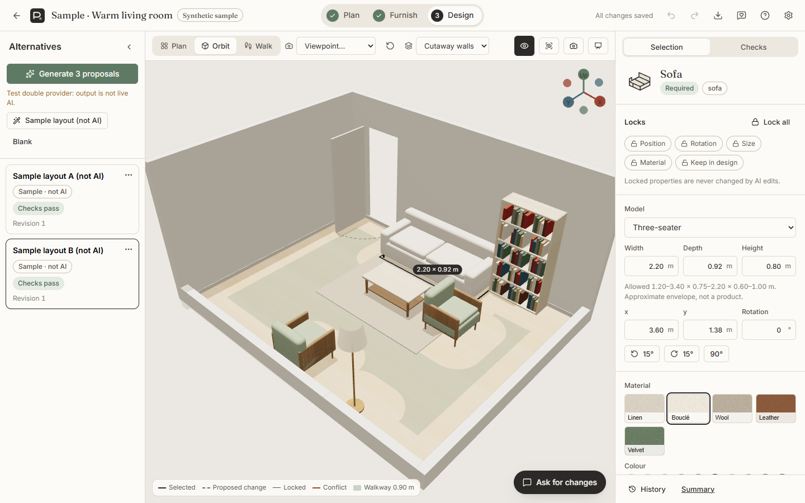
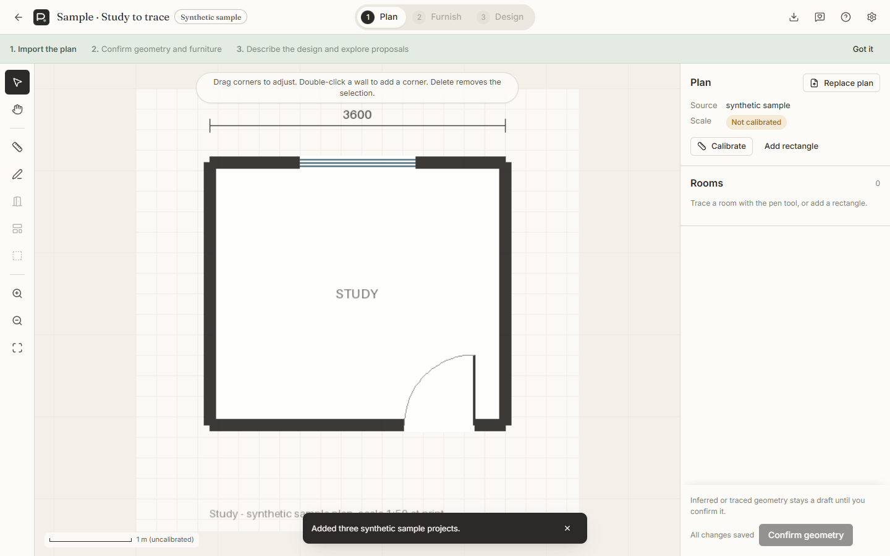
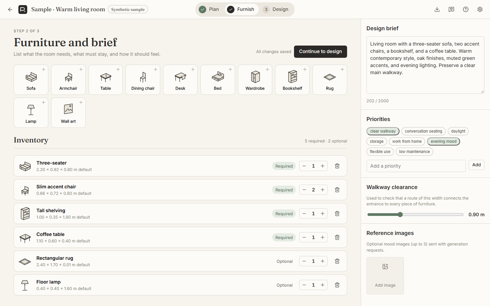
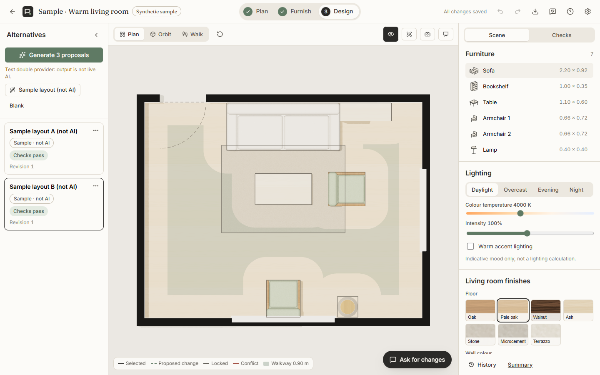
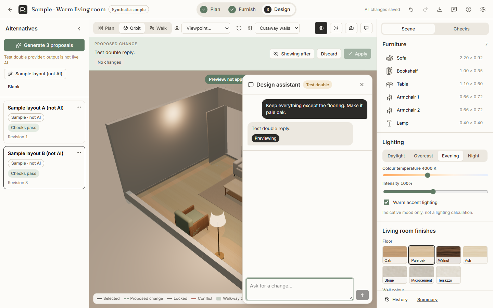

# ReSpace Studio

ReSpace Studio is an AI-assisted interior concept-design workspace for architects and interior designers. You upload a floor plan, calibrate and confirm its geometry, describe the furniture and the brief, and get **editable 3D proposals**. Every proposal is checked geometrically. You can lock, compare, revise and present them.



> ReSpace supports concept exploration. It does not check building-code compliance or structure, and it does not perform engineering-grade lighting analysis. Furniture is approximate, and AI design quality is not guaranteed.

## What it does
1. **Plan.** Import a PNG or JPEG, or pick a page from a PDF (rendered in the browser). Mark a known length to set the scale, trace rooms with snapping, and add doors and windows. Optionally ask the AI for a *draft* outline. Confirm the geometry.
2. **Furnish.** Choose from the furniture catalogue with counts, required or optional status, existing pieces to keep, size ranges and finishes. Add the brief, priorities, reference images and the walkway clearance.
3. **Design.** Generate three AI proposals, or use the clearly labelled **rule-based sample layouts (not AI)**. Then:
   - work in plan, orbit or walkthrough view;
   - drag furniture with wall and grid snapping, edit dimensions, rotate, change materials and lighting;
   - lock whole objects or single properties;
   - check each proposal: containment, collisions, door swings, counts, sizes, and a **walkway connectivity check**;
   - ask for changes in plain language: the edit is previewed, the affected objects are highlighted, and you apply or discard it;
   - use undo/redo, revision history, compare, the printable summary and furniture schedule, presentation mode, PNG export and JSON export/import;
   - record tester feedback against each design revision.

| | |
|---|---|
|  |  |
|  |  |

*Screenshots are taken from the running app with synthetic sample plans. The proposal-preview screenshot uses the labelled CI test double, not live AI.*

## Requirements (Windows)
- Python 3.12 (`py -3.12`)
- Node.js 22 and npm
- Optional: a Google Gemini API key from Google AI Studio (free tier)

## Setup
```powershell
git clone https://github.com/RahulMammen/respace-studio.git
cd respace-studio
powershell -ExecutionPolicy Bypass -File scripts/setup.ps1
```
Setup creates `backend/.venv`, installs dependencies, builds the frontend, and creates `backend/.env` from `backend/.env.example` with a random session secret.

### Add the AI key (optional)
1. Open `backend/.env` in your editor. Git ignores this file.
2. Set `GEMINI_API_KEY=` to your key. Don't paste the key anywhere else, and never commit it.
3. Restart the server. To check the key with one small synthetic request:
```powershell
cd backend
.venv\Scripts\python -m app.ai.smoke
```
Without a key, everything except the AI features works, and the AI buttons explain why they are disabled.

## Run
```powershell
powershell -ExecutionPolicy Bypass -File scripts/start.ps1
```
Open http://127.0.0.1:8000, create an account, and click **Add sample projects**.

- **Same-network testing:** `scripts/start.ps1 -Lan` prints `http://<your-LAN-IP>:8000` for testers on the same private network. It never changes firewall settings, so Windows may ask you. Use it only on trusted networks. See [docs/testing-guide.md](docs/testing-guide.md).
- **Development with hot reload:** `powershell -ExecutionPolicy Bypass -File scripts/dev.ps1`, then open http://localhost:5173.

## Data handling
- Plans, the database and exports stay in `backend/data/`, which Git ignores.
- The API key exists only on the server.
- AI requests send confirmed geometry, the furniture list, the brief text, selected reference images and, for reviews, a screenshot of the current view to Google Gemini. Free-tier content may be used by Google and seen by human reviewers. **Use synthetic or anonymised plans.** Details: [docs/ai-design.md](docs/ai-design.md).

## Tests
```powershell
cd backend;  .venv\Scripts\python -m pytest -q; .venv\Scripts\python -m ruff check app tests; .venv\Scripts\python -m mypy app
cd ..\frontend; npm run lint; npx tsc -b; npm test; npm run build; npx playwright test
```
CI runs all of these on every push. Browser tests and CI use a labelled AI **test double**; they never make live AI calls. Live AI results are recorded separately in [HANDOFF.md](HANDOFF.md).

## Documentation
- [Architecture and scene schema](docs/architecture.md)
- [AI generation, validation, repair and editing](docs/ai-design.md)
- [Geometry conventions, checks and walkway method](docs/geometry.md)
- [Architect testing guide](docs/testing-guide.md) · [Five-minute demo](docs/demo-script.md) · [Interview notes](docs/interview-notes.md)
- [Deployment and hosting requirements](docs/deployment.md) · [Limitations and roadmap](docs/limitations-and-roadmap.md)
- [Asset provenance and licences](ASSETS.md) · [Validation evidence](HANDOFF.md) · [Progress log](PROGRESS.md)

## Stack
React 19, TypeScript, Vite 8, three.js 0.186 with React Three Fiber 9 and drei 10, Zustand, pdf.js · Python 3.12, FastAPI, Pydantic 2, SQLAlchemy 2, Alembic, SQLite, Shapely, Pillow, pwdlib (Argon2id), google-genai · pytest, Vitest, Playwright, GitHub Actions.
